# HowTo: Microsoft 365, Entra ID & Intune Lab

This guide records the steps used to recreate the lab. Microsoft portal labels can change over time. Use a disposable test tenant and test VMs.

## Lab Environment

- Microsoft 365 Business Premium trial tenant
- VMware Workstation
- Windows 11 Enterprise Evaluation client VM
- Windows Server 2022 Evaluation VM for Active Directory
- VMware virtual networks: an internet-enabled NAT network and a separate private/host-only network for isolated lab traffic
- Example AD domain used for the rebuilt pilot: `jh.test`
- Example pilot OU: `CloudSync-Pilot`

Keep a separate administrative account and test-user accounts. Do not use production accounts or devices.

## 1. Create Users, Groups, and a Delegated Admin

1. Open the Microsoft 365 admin center and go to **Users → Active users → Add multiple users**.
2. Create a small test workforce. In this lab, I created 10 users across Sales, HR, Finance, IT, and Operations.
3. For each user, set a display name, username, department, job title, and location. Assign a license only when that test user needs licensed services.
   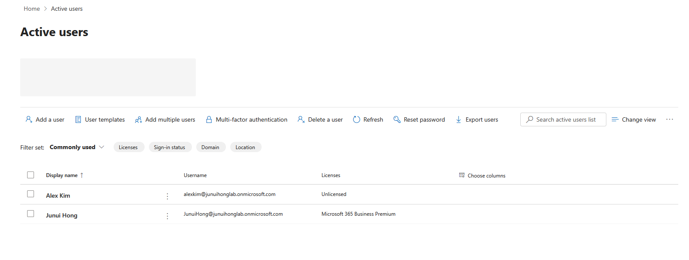
   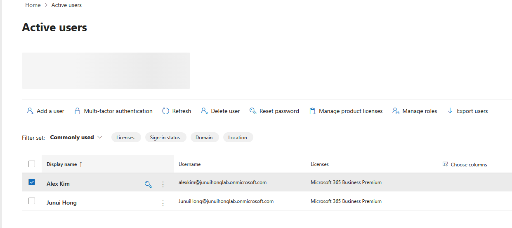
4. Go to **Teams & groups → Active teams & groups → Security groups** and create:
   - `SG-Sales-Users`
   - `SG-HR-Users`
   - `SG-Finance-Users`
   - `SG-IT-Users`
   - `SG-Operations-Users`
5. Add each test user to the matching department group. Confirm the group membership before using the group in assignments.
   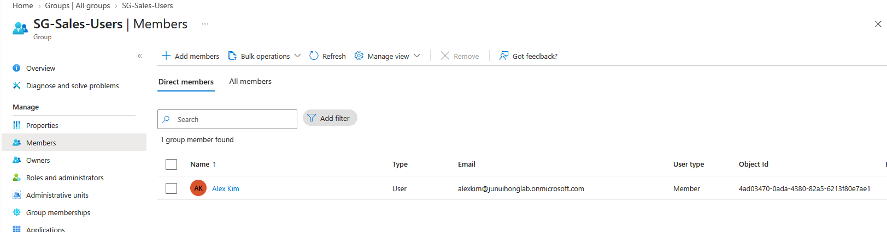
   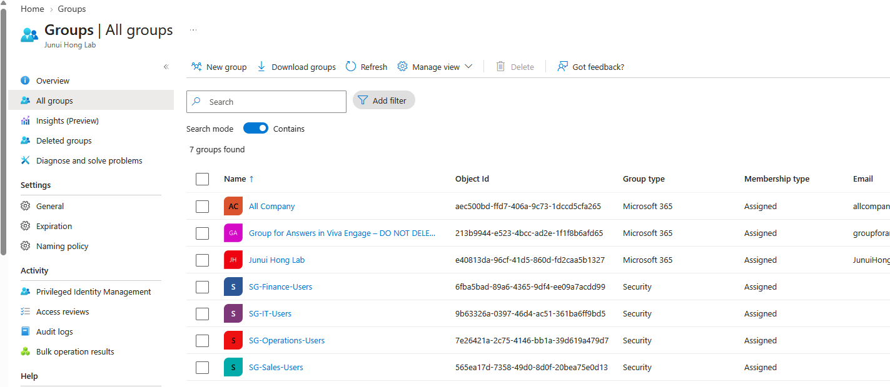
6. In the Microsoft Entra admin center, open **Identity → Roles & admins**. Assign the Helpdesk Administrator role to the lab IT support test account. Check the selected account and role before saving.
   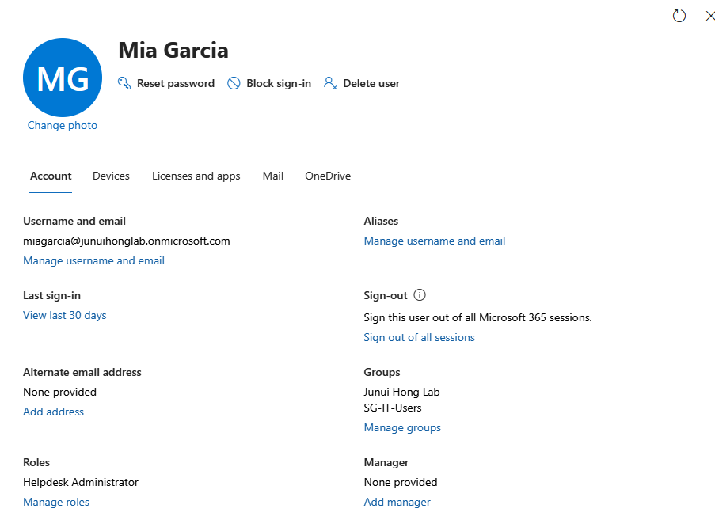

## 2. Create and Test the Sales Shared Mailbox

1. In the Microsoft 365 admin center, go to **Teams & groups → Shared mailboxes → Add a shared mailbox**.
2. Create a mailbox named **Sales** with address `sales@<your-tenant-domain>`.
   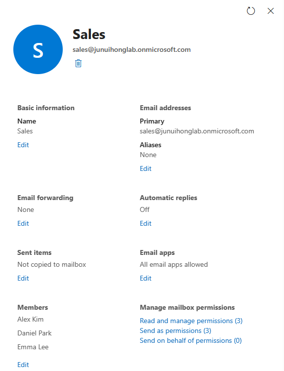
3. Open the mailbox and add three test users as members.
4. In **Manage mailbox permissions**, grant the test users **Read and manage** and **Send as** permissions.
5. Sign in to Outlook as a member after permissions have propagated. Open the shared mailbox or select it as the From address.
6. Send a test message to the lab administrator and confirm the received message shows **Sales** as the sender.
   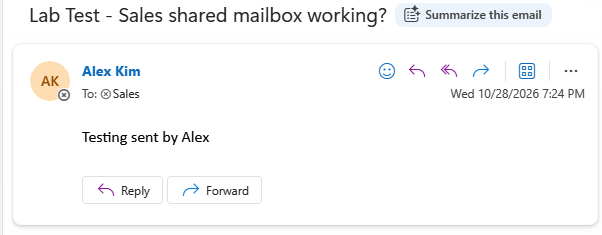
   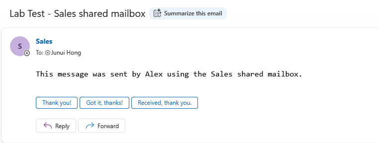

## 3. Join and Enroll the Windows VM

1. In VMware, create a Windows 11 x64 VM. The lab client used 2 vCPUs, 8 GB RAM, an 80 GB virtual disk, and a virtual TPM.
2. Attach the Windows 11 Enterprise Evaluation ISO and complete Windows setup with a local account first.
   
3. In Windows, open **Settings → Accounts → Access work or school → Connect**.
4. Choose the option to join the device to Microsoft Entra ID, then sign in with the test user assigned to the device (for example, `alexkim@<your-tenant-domain>`).
5. Complete the join and sign in to Windows with the Entra ID test account.
   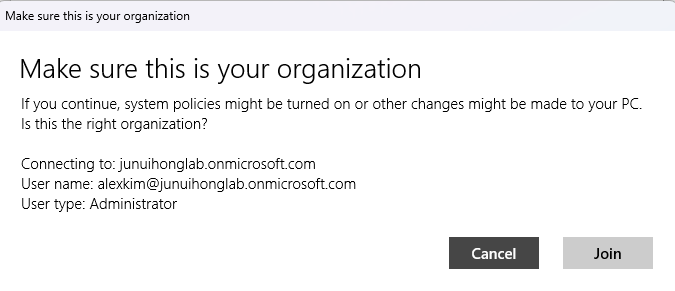
   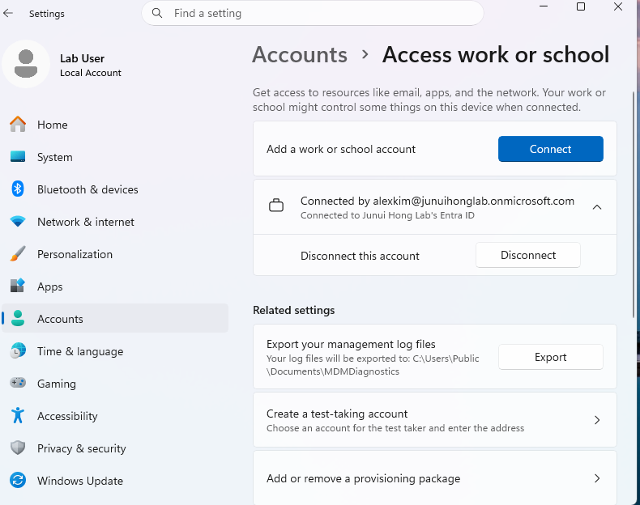
   
6. In Windows, return to **Settings → Accounts → Access work or school** and confirm the device is connected to the tenant.
7. In the Intune admin center, open **Devices → Windows → Windows devices** and wait for the device to appear. Use **Sync** on the device record or start a sync from Windows if needed.
   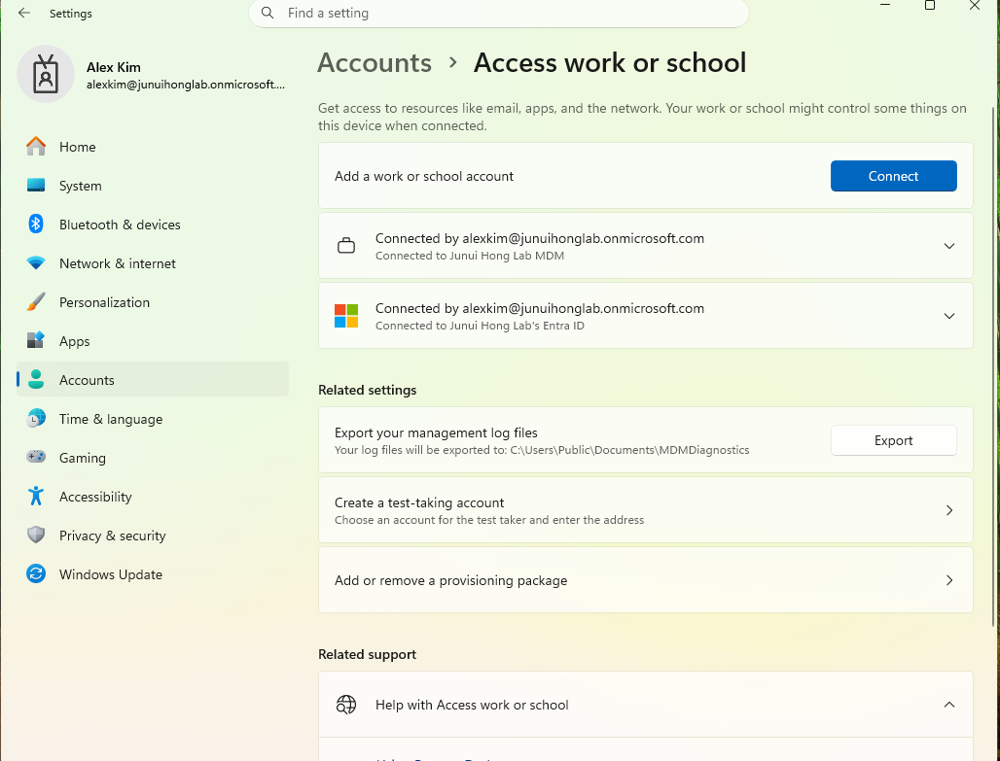
   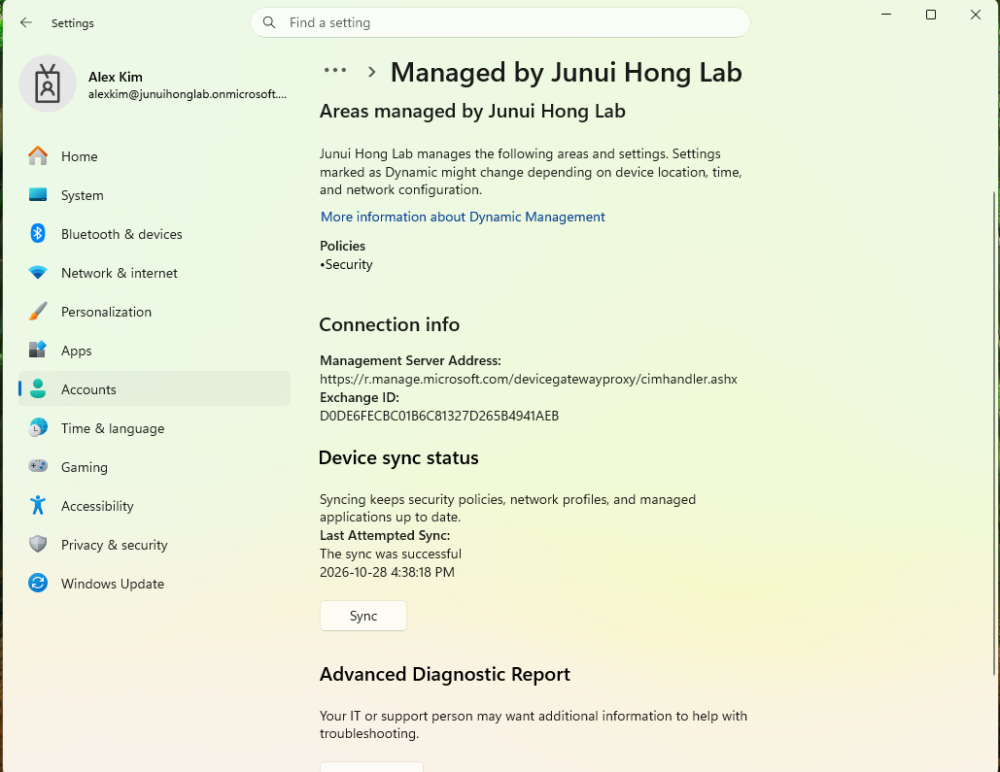
   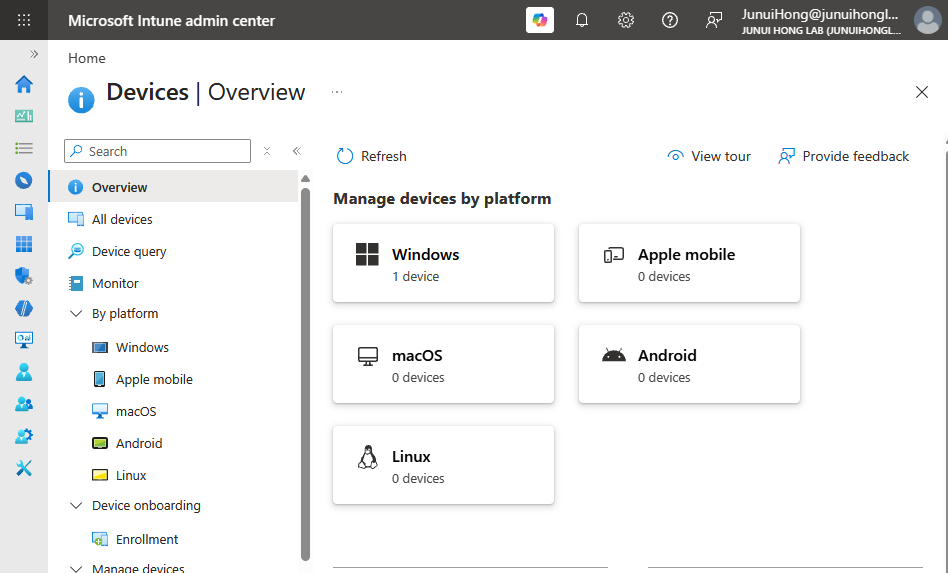
   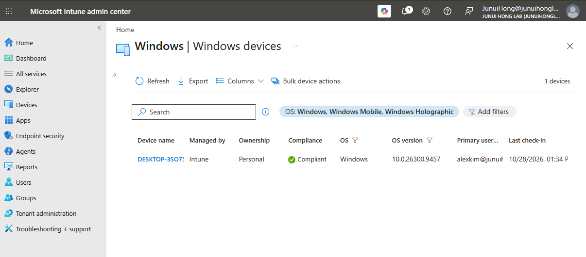

## 4. Configure BitLocker Compliance

1. In the Intune admin center, go to **Devices → Compliance → Policies → Create policy**.
2. Select **Windows 10 and later**, then create a Windows 10/11 compliance policy.
3. Give it a clear name, such as `WIN-COMP-Sales-BitLocker`.
4. Under **Compliance settings → Device Health**, set **Require BitLocker** to **Require**. Leave unrelated settings unconfigured for this test.
5. Under **Actions for noncompliance**, keep the default grace period or set a short lab grace period.
6. Assign the policy to `SG-Sales-Users`, then review and create it.
7. On the Windows VM, open **Control Panel → System and Security → BitLocker Drive Encryption**. If setup reports bootable media, disconnect the Windows ISO from the VM's CD/DVD device, restart Windows, and start BitLocker again.
   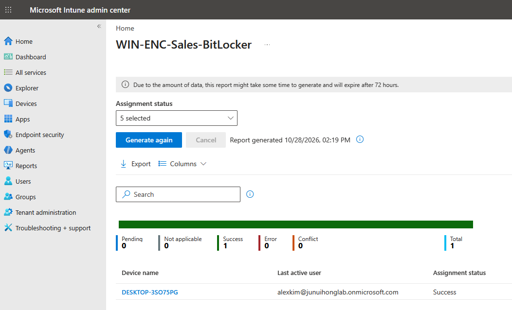
   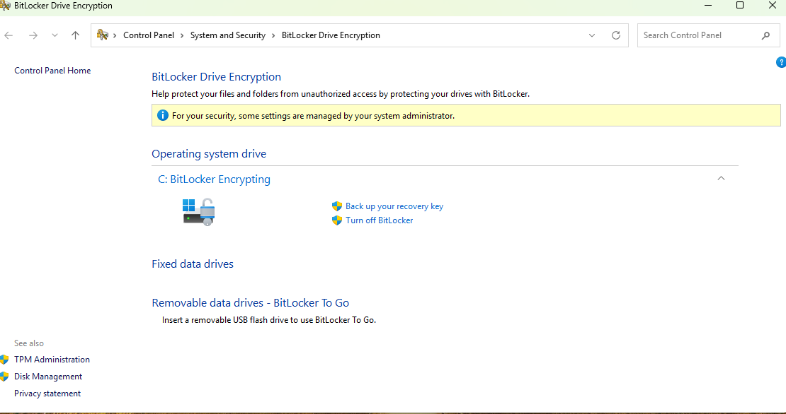
   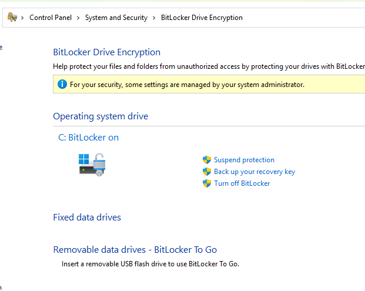
8. Allow the device to check in. In Intune, open the device record and **Device compliance**. Confirm the BitLocker policy result and overall compliance state.
   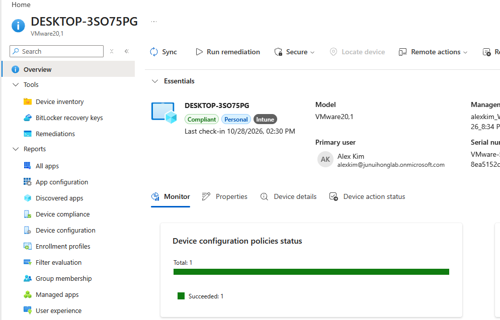

## 5. Deploy an Intune App

1. In the Intune admin center, go to **Apps → Windows → Add**.
2. Choose **Microsoft Store app (new)** and search for **Company Portal**.
3. Add the app, save its app information, and assign it as **Required** to `SG-Sales-Users`.
4. In the assignment settings, use the default notification and restart options for this lab. Review and save.
5. On the Windows VM, start a device sync and leave it online. Check Windows notifications or the Start menu for Company Portal.
6. Confirm installation in Windows. Intune's install status report can take longer to update than the device notification.
   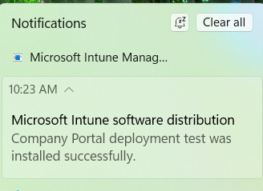

## 6. Create and Test an Exchange Mail Flow Rule

1. Open the Exchange admin center and go to **Mail flow → Rules → Add a rule**.
2. Name the rule `LAB - Tag Sales mailbox messages`.
3. Set the condition to **The recipient is** `sales@<your-tenant-domain>`.
4. Set the action to **Prepend the subject of the message with** `[LAB] - `.
5. Do not add an exception that checks for the same prefix. Save the rule.
6. Send a new message to the Sales shared mailbox. Confirm that the received subject starts with `[LAB] -`.
   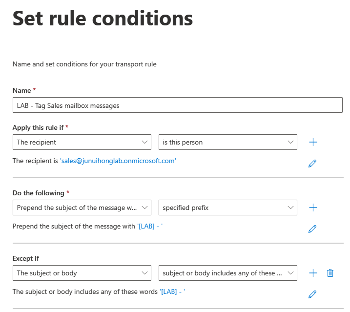
   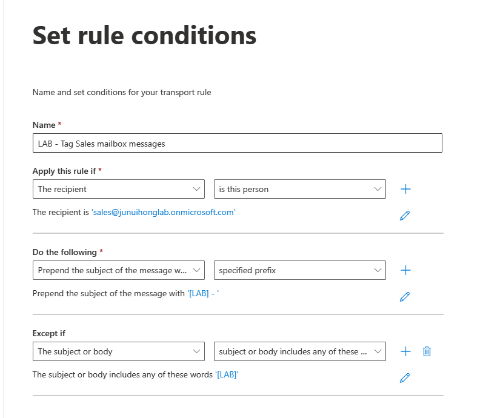
   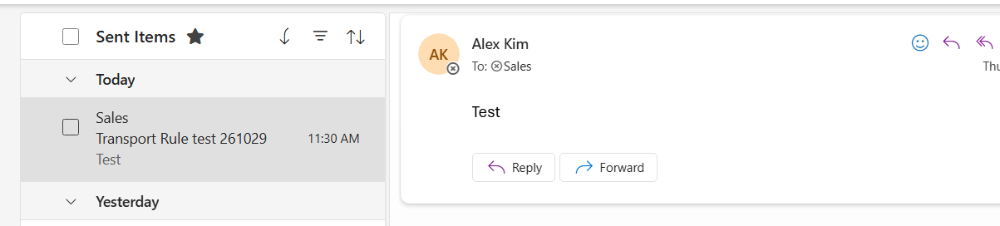
   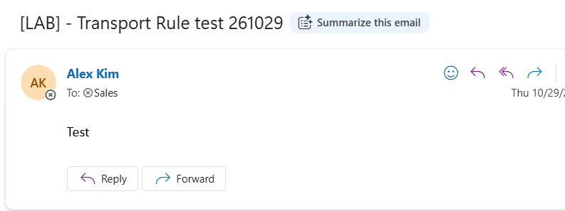

## 7. Create a Conditional Access Policy in Report-Only Mode

1. In the Microsoft Entra admin center, go to **Protection → Conditional Access → Policies → New policy**.
2. Name it `CA-Sales-Require-MFA-Compliant-Device`.
3. Under **Users**, include `SG-Sales-Users`. Exclude your emergency access/admin account to avoid locking yourself out.
4. Under **Target resources**, select the cloud app used for the test, or all resources if the lab tenant allows it.
5. Under **Conditions → Device platforms**, configure the intended Windows scope. Under **Grant**, select **Require multifactor authentication** and **Require device to be marked as compliant**.
6. Set **Enable policy** to **Report-only**, then create the policy.
7. Sign in to a test cloud app from the compliant Windows VM. In **Monitoring → Sign-in logs**, open the sign-in and review **Report-only** and **Conditional Access** results.
8. Keep the policy in Report-only mode for this lab. The screenshots show evaluation only; they do not show enforced access control.
   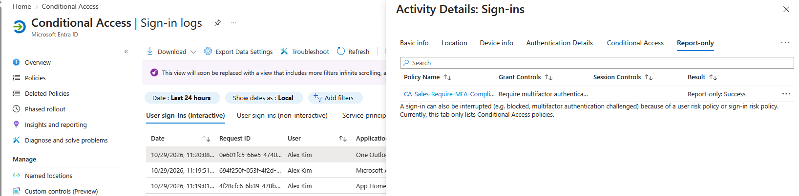

## 8. Review Built-In Email Protection

1. Open the Microsoft Defender portal and go to **Email & collaboration → Policies & rules → Threat policies → Anti-spam policies**.
2. Open the built-in inbound anti-spam policy and review its status and settings.
3. Record the default policy as reviewed. In this lab, custom anti-spam and anti-malware policy creation returned a portal client error, so do not record a custom policy as created.

## 9. Configure the First Hybrid AD Pilot

1. In VMware, create a Windows Server VM and install Windows Server 2022 Evaluation with Desktop Experience.
2. Connect the server to the lab network that provides internet access during setup. For a separate isolated network, use a different private VMnet and keep its subnet separate from other active VMware networks.
3. Assign the server a static IPv4 address and configure its DNS server to the server's own address after AD DS/DNS is installed. Configure the VMnet gateway/DHCP settings to match the selected VMware network.
4. In Server Manager, install **Active Directory Domain Services** and **DNS Server**, then promote the server to a domain controller for a new forest. The rebuilt pilot used `jh.test`.
5. In **Active Directory Users and Computers**, create an OU named `CloudSync-Pilot` and a test user named **Hybrid Pilot** inside it.
6. Add the tenant's `onmicrosoft.com` UPN suffix in **Active Directory Domains and Trusts → domain Properties → UPN Suffixes**. Set the pilot user's UPN to `hybridpilot@<your-tenant-domain>`.
   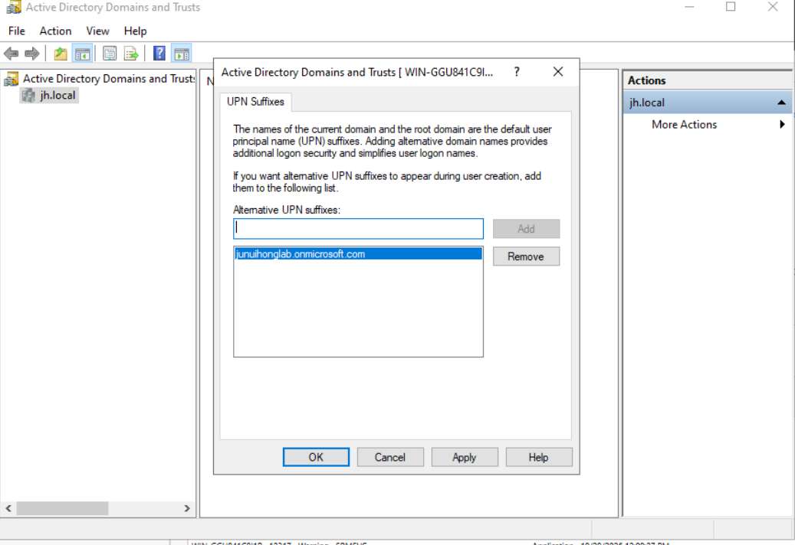
   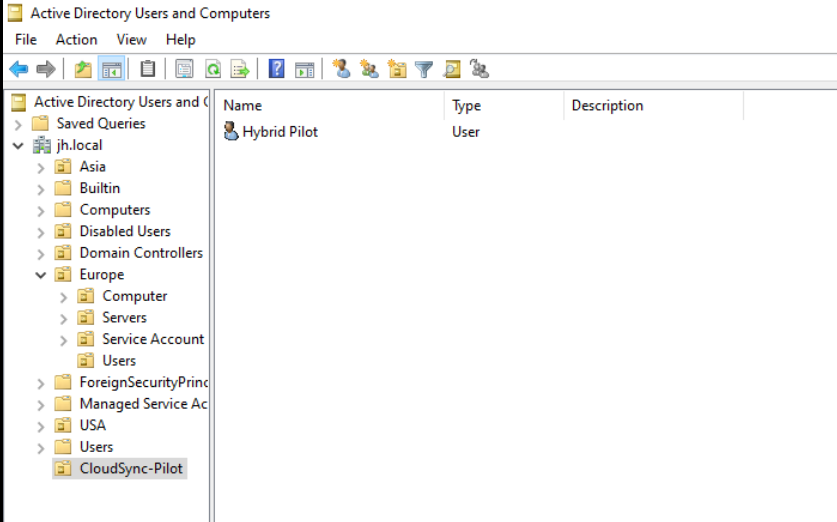
7. Download the Microsoft Entra provisioning agent from the Cloud Sync configuration page and install it on the Windows Server VM.
8. In the configuration wizard, select **Connect to your Active Directory domain(s)**, authenticate with an Entra tenant administrator, choose **Create gMSA**, enter domain administrator credentials, select the AD domain, and confirm.
   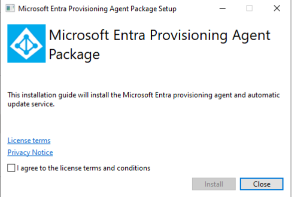
9. In the Entra admin center, go to **Microsoft Entra Connect → Cloud Sync → New configuration** and select **AD to Microsoft Entra ID sync**.
10. Select the AD domain and scope the configuration to the `CloudSync-Pilot` OU. Review the attribute mappings and save the configuration.
11. To get the pilot user's current DN, run this on the domain controller:
    ```powershell
    Get-ADUser -Identity hybridpilot -Properties UserPrincipalName,DistinguishedName,ObjectGUID |
      Format-List Name,SamAccountName,UserPrincipalName,DistinguishedName,ObjectGUID
    ```
12. Open the configuration's **Provision on demand** page, choose **User**, and enter the exact DistinguishedName shown by Active Directory. Run the request.
13. Check **Provisioning logs** and the Entra users list. Record the actual result. In this lab, Provision on demand timed out in the first `jh.local` configuration and again after rebuilding the pilot as `jh.test`; no successful user sync was verified. See [ProblemSolving.md](ProblemSolving.md) for evidence and troubleshooting steps.

## 10. Check the Lab Results

1. Confirm the created cloud users and department groups in Entra ID.
2. Confirm the Sales shared mailbox test email and the mail flow subject prefix in Outlook.
3. Confirm the Windows device appears in Intune and shows the expected compliance status.
4. Confirm Company Portal is installed on the Windows VM.
5. Confirm Conditional Access results in sign-in logs as **Report-only**.
6. Keep unresolved items documented with their observed result; do not mark an operation successful without verification.
