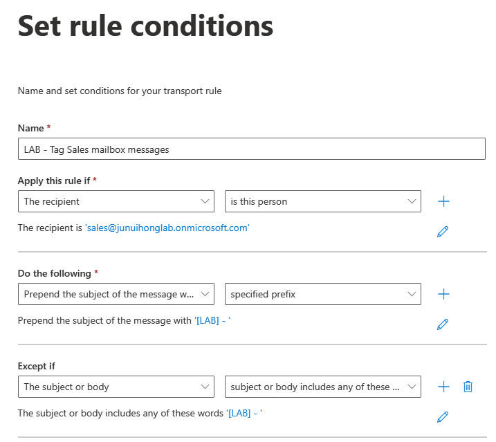
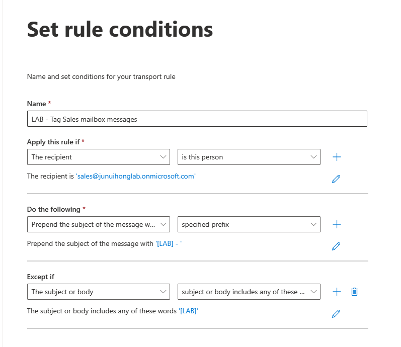
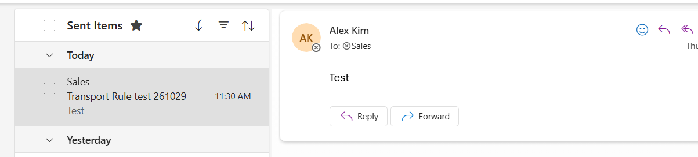
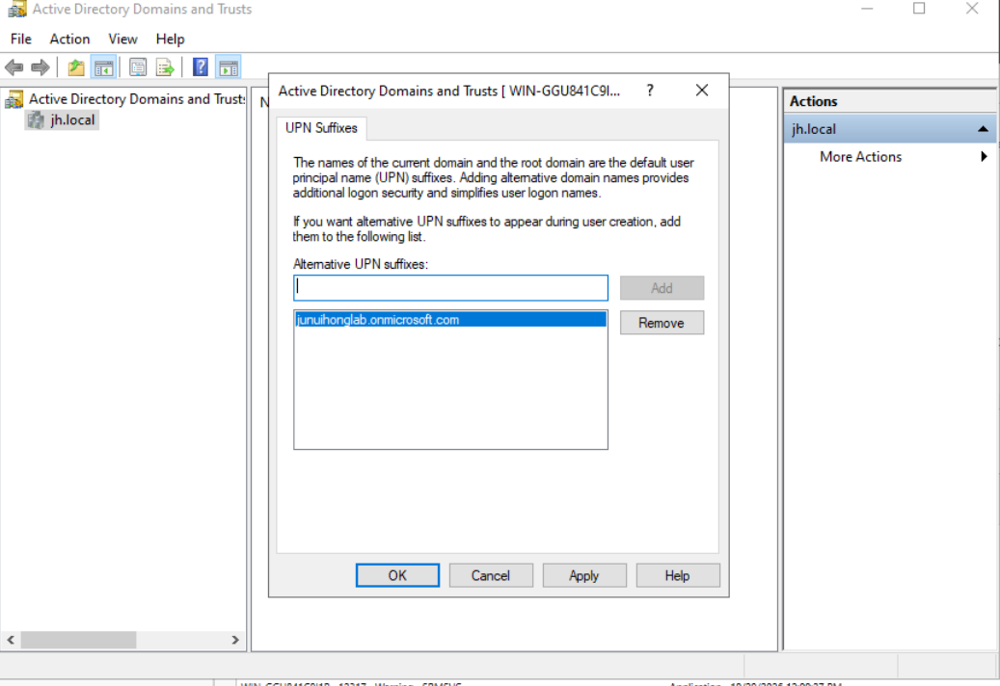

# HowTo: Microsoft 365, Entra ID & Intune Lab

This guide lists the configuration steps used in the lab.

## Lab Environment

- Microsoft 365 Business Premium trial tenant: `junuihonglab.onmicrosoft.com`
- Windows 11 Enterprise Evaluation VM in VMware Workstation
- Windows Server 2022 domain controller VMs
- First AD domain: `jh.local`
- Rebuilt AD domain: `jh.test`

## 1. Create Users, Groups, and a Delegated Admin

1. In the Microsoft 365 admin center, open **Users > Active users > Add a user**.
2. Create cloud users and enter their display names, usernames, passwords, departments, and job titles.
3. Assign a Microsoft 365 Business Premium license to the users who need it.
4. Open **Teams & groups > Active teams & groups > Security groups** and create assigned-membership groups:
   - `SG-Sales-Users`
   - `SG-HR-Users`
   - `SG-Finance-Users`
   - `SG-IT-Users`
   - `SG-Operations-Users`
5. Add each test user to the matching department group.
6. In the Entra admin center, open **Roles & administrators**, select **Helpdesk Administrator**, and assign the role to the IT helpdesk test user.

## 2. Create and Test the Sales Shared Mailbox

1. In the Exchange admin center, open **Recipients > Mailboxes > Add a shared mailbox**.
2. Create `sales@junuihonglab.onmicrosoft.com`.
3. Add Alex Kim, Daniel Park, and Emma Lee as mailbox members.
4. Grant the test users **Read and manage** and **Send as** access.
5. Sign in as Alex and open the Sales shared mailbox in Outlook.
6. Send a test message using the Sales mailbox as the sender.
7. Open the recipient's mailbox and verify the sender and message.

## 3. Join and Enroll the Windows VM

1. Create a Windows 11 Enterprise Evaluation x64 VM in VMware Workstation. The lab VM uses 8 GB RAM, 2 vCPUs, and an 80 GB virtual disk.
2. Connect the VM to a network with internet access.
3. Complete Windows setup with a local account.
4. Open **Settings > Accounts > Access work or school > Connect**.
5. Sign in with the Entra test user and complete the Entra ID join.
6. Start device management enrollment. Confirm both the Entra ID connection and MDM connection appear in **Access work or school**.
7. Sign in to Windows as Alex Kim.
8. In Windows, open **Settings > Accounts > Access work or school**, select the connected account, and choose **Info > Sync**.
9. In the Intune admin center, open **Devices > Windows > Windows devices**, refresh, and open the device to review its primary user and check-in.

## 4. Configure BitLocker Compliance

1. In Intune, open **Devices > Compliance > Policies > Create policy**.
2. Select **Windows 10 and later** and the Windows 10/11 compliance policy type.
3. Name the policy `WIN-COMP-Sales-BitLocker`.
4. In **Compliance settings**, require BitLocker.
5. Assign the policy to `SG-Sales-Users` and create it.
6. Open **Endpoint security > Disk encryption > Create policy**.
7. Select Windows, name the policy `WIN-ENC-Sales-BitLocker`, and enable device encryption.
8. Under **Operating System Drives**, enable drive encryption and select **Used Space Only encryption**. Configure recovery options.
9. Assign the policy to `SG-Sales-Users` and create it.
10. In VMware settings, disconnect the Windows installation ISO from the virtual CD/DVD drive.
11. In the Windows VM, open **Control Panel > System and Security > BitLocker Drive Encryption** and start BitLocker if it has not started from policy.
12. Wait for encryption to finish, sync the device, and refresh its Intune compliance status.
13. Confirm the device is marked **Compliant** and that a recovery key is available in Intune. Do not copy the recovery key into repository files.

## 5. Deploy an Intune App

1. In Intune, open **Apps > Windows > Create**.
2. Add **Company Portal** as a Microsoft Store app (new) and name the deployment `Company Portal deployment test`.
3. Assign it as **Required** to `SG-Sales-Users`.
4. Sync the Windows VM from **Access work or school**.
5. Wait for the Windows installation notification and review the app install status in Intune.

## 6. Create and Test an Exchange Mail Flow Rule

1. In the Exchange admin center, open **Mail flow > Rules > Add a rule**.
2. Name the rule `LAB - Tag Sales mailbox messages`.
3. Set the recipient condition to `sales@junuihonglab.onmicrosoft.com`.
4. Set the action to prepend `[LAB] - ` to the subject.
5. Add an exception for messages whose subject or body includes `[LAB] -`.
6. Save the rule.
7. Send a new test email to the Sales mailbox with a subject that does not already contain the tag.
8. Verify the received message subject begins with `[LAB] -`.

## 7. Create a Conditional Access Policy in Report-Only Mode

1. In the Entra admin center, open **Protection > Conditional Access > Policies > New policy**.
2. Name it `CA-Sales-Require-MFA-Compliant-Device`.
3. Include the `SG-Sales-Users` group.
4. Select **Office 365** as the target resource.
5. Under grant controls, require multifactor authentication and a compliant device.
6. Set the policy state to **Report-only** and create it.
7. Sign in to an Office 365 app from the enrolled, compliant Windows VM using a regular Edge browser profile.
8. Open **Sign-in logs**, select the sign-in, and check the Conditional Access or Report-only tab.

## 8. Review Default Email Protection

1. In the Microsoft Defender portal, open **Email & collaboration > Policies & rules > Threat policies > Anti-spam policies**.
2. Review the default inbound anti-spam policy and its status.

## 9. Configure the First Hybrid AD Pilot

1. In Active Directory Users and Computers, create an OU named `CloudSync-Pilot`.
2. Create the `Hybrid Pilot` user in that OU and set the UPN to `hybridpilot@junuihonglab.onmicrosoft.com`.
3. In **Active Directory Domains and Trusts**, add `junuihonglab.onmicrosoft.com` as an alternate UPN suffix if it is not available.
4. On the Windows Server domain controller, install the Microsoft Entra provisioning agent.
5. In the agent configuration wizard, authenticate with a tenant administrator account, select **Create gMSA**, enter domain administrator credentials, select the AD domain, and complete the configuration.
6. In the Entra admin center, open **Cloud sync > New configuration > AD to Microsoft Entra ID sync** and select the domain.
7. Set the scoping filter to **Sync selected organizational units** and add the `CloudSync-Pilot` OU.
8. Review attribute mappings and configure the sync.
9. Use **Provision on demand** with the pilot user's distinguished name. Review the operation result and provisioning logs.
10. Review the configuration overview and the provisioning-agent trace.

## 10. Rebuild the AD Pilot and Retry Cloud Sync

1. Create a fresh Windows Server 2022 VM in VMware Workstation and connect it to a network with internet access.
2. Install **Active Directory Domain Services** and **DNS**, then promote the server to a new forest using the lab domain `jh.test`.
3. Confirm the new domain controller and DNS server are available in Server Manager and DNS Manager.
4. Create a `CloudSync-Pilot` OU and a pilot user in the new domain.
5. Add `junuihonglab.onmicrosoft.com` as an alternate UPN suffix and set the pilot user's UPN to `hybridpilot@junuihonglab.onmicrosoft.com`.
6. Install the Microsoft Entra provisioning agent on the new domain controller.
7. In the agent configuration wizard, authenticate to the tenant, create a gMSA using domain administrator credentials, select `jh.test`, and finish the wizard.
8. In Entra Cloud Sync, create an **AD to Microsoft Entra ID** configuration for `jh.test`.
9. Scope the configuration to the pilot OU and review the attribute mappings.
10. Use **Provision on demand** for the pilot user, then review **Provisioning logs**, **Agents**, and the configuration's cycle status.
11. Verify the cloud user object in Entra ID before treating synchronization as complete.

Hybrid sync results and troubleshooting notes are in [ProblemSolving.md](ProblemSolving.md).
