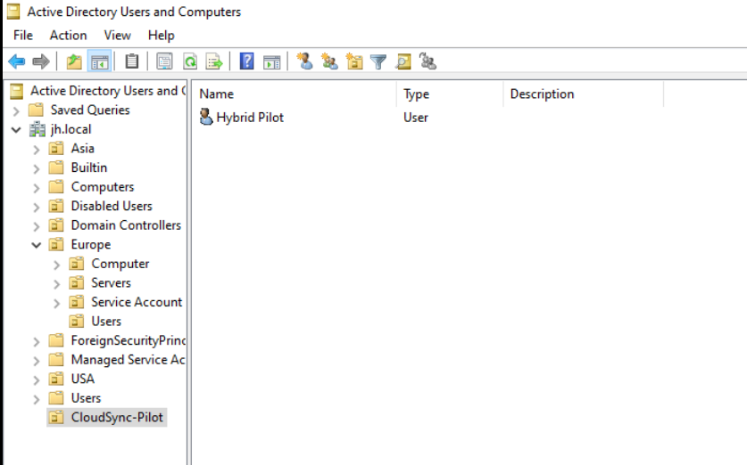
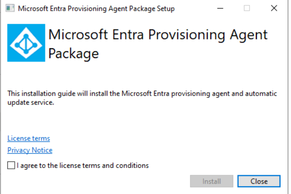

# Microsoft 365, Entra ID & Intune Administration Lab

I built this lab to practice everyday Microsoft 365 administration in a small simulated company. I created users and groups, configured mailbox access, joined a Windows device to Entra ID, enrolled it in Intune, deployed an app, and tested security policies.

I also tried connecting an on-premises Active Directory environment to Microsoft Entra ID with Cloud Sync. I rebuilt the AD lab and investigated the timeouts, but I could not verify a successful user sync. I documented the result and the evidence instead of presenting it as a working integration.

## Lab Environment

- Microsoft 365 Business Premium trial tenant: `junuihonglab.onmicrosoft.com`
- VMware Workstation
- Windows 11 Enterprise Evaluation client VM
- Windows Server 2022 AD lab VMs
- AD pilot domains: first `jh.local`, then a clean rebuild using `jh.test`

## What I Built and Verified

### Entra ID users, groups, and delegated access

I created a 10-person test workforce across Sales, HR, Finance, IT, and Operations. I organized users into department security groups and assigned the Helpdesk Administrator role to an IT support test account.

### Exchange Online shared mailbox and mail flow

I created a Sales shared mailbox, added three members, and verified that a test user could send as the mailbox. I also created a mail flow rule that adds `[LAB] -` to messages sent to Sales and confirmed the subject prefix in the delivered email.

### Intune enrollment, app deployment, and device security

I joined a Windows 11 VM to Entra ID and enrolled it in Intune. I assigned Company Portal to the Sales group and confirmed its installation in Windows. I configured BitLocker encryption and confirmed the device reported Compliant after checking in.

### Conditional Access evaluation

I created a Sales policy requiring MFA and a compliant device. I kept it in Report-only mode and reviewed sign-in logs. A sign-in from the enrolled, compliant VM showed a successful Report-only evaluation.

The policy evaluated the sign-in but was not enabled to enforce MFA or block access.

## Hybrid Identity: Investigation, Not a Completed Sync

I created an AD pilot user, installed and registered the Microsoft Entra provisioning agent, scoped Cloud Sync to a pilot OU, and tried **Provision on demand**. The first attempt used `jh.local`. After repeated timeouts, I rebuilt the AD environment as `jh.test` and retried with a clean domain.

The agent registered and appeared active, and Cloud Sync showed Healthy at times. However, the user/group cycle did not complete, on-demand provisioning timed out, and I could not confirm the pilot user in Entra ID. I therefore describe this as an unresolved troubleshooting case, not a successful hybrid deployment.

The investigation included checking the pilot user's AD attributes and OU, agent service and logs, .NET version, proxy settings, firewall rules, DNS resolution, outbound TCP connectivity, and a Packet Monitor capture. Those checks narrowed the symptoms to a provisioning/connector timeout but did not identify a confirmed root cause. The raw packet capture is not included in the repository.

## Email Protection Policy Review

I reviewed the tenant's default inbound anti-spam policy and confirmed it was Always on. Attempts to create custom anti-spam and anti-malware policies returned an Exchange portal client error, so I have not listed those custom policies as created.

## What the Lab Shows

- User and group administration in Entra ID and Microsoft 365
- Shared mailbox permissions and Exchange mail flow rules
- Windows Entra ID join and Intune MDM enrollment
- Required app deployment and endpoint check-in
- BitLocker configuration and compliance validation
- Conditional Access sign-in evaluation in Report-only mode
- Evidence-based troubleshooting with a clearly documented unresolved outcome

This is a personal lab, not a production tenant or production security configuration.

## Guides

- [HowTo.md](HowTo.md) — configuration steps used in the lab
- [ProblemSolving.md](ProblemSolving.md) — issues, troubleshooting approach, and results
