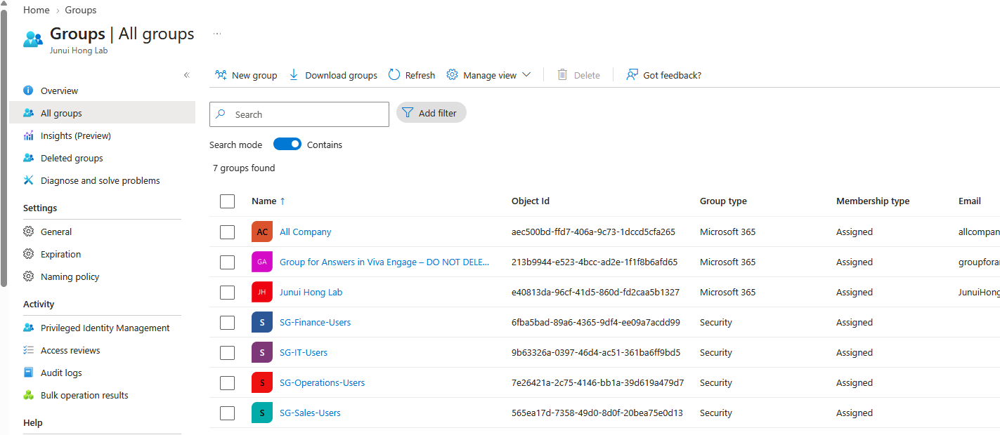
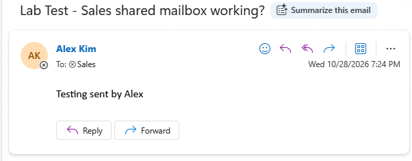
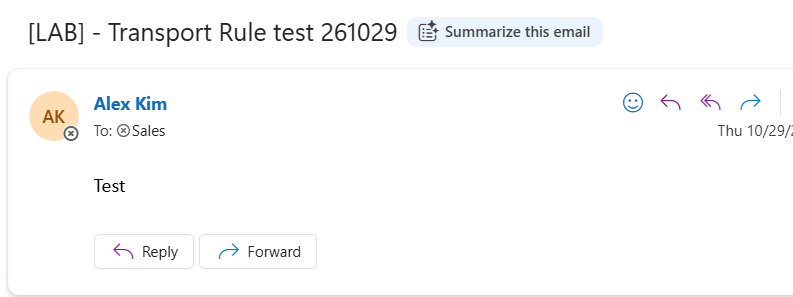
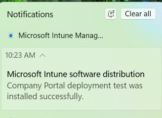
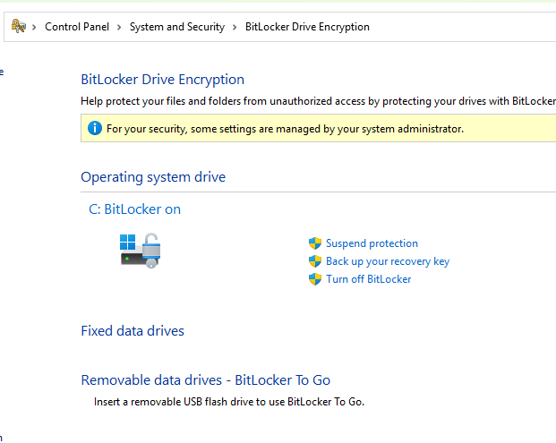
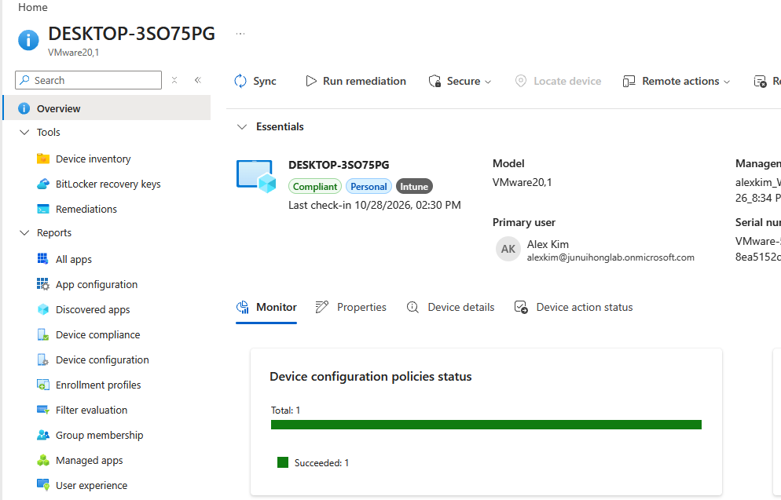
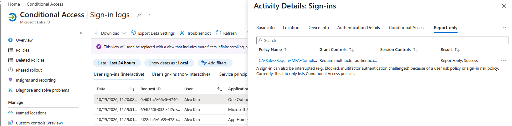
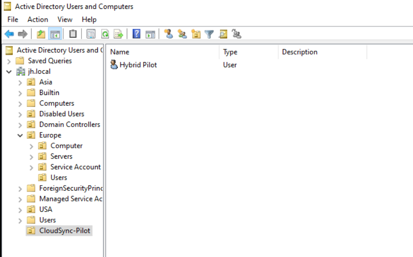
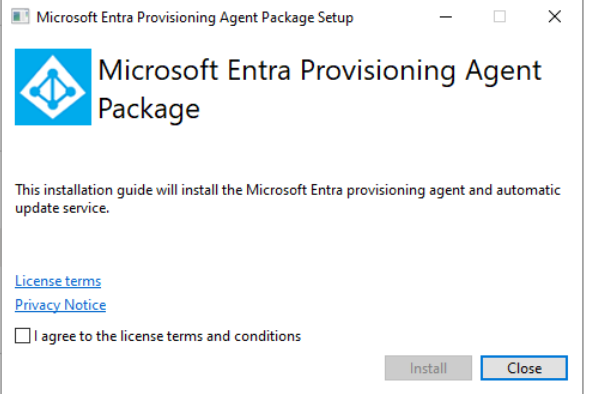

# Microsoft 365, Entra ID & Intune Administration Lab

## Summary

I built a small company lab with Microsoft 365, Microsoft Entra ID, Exchange Online, and Intune. I created users and department groups, configured a shared mailbox and mail flow rule, enrolled a Windows 11 VM, deployed Company Portal, and tested device security and Conditional Access.

I also tried to connect an on-premises Active Directory lab to Entra ID with Cloud Sync. The agent registered, but user provisioning timed out in two lab environments. I documented the investigation and kept the result marked as unresolved.

## Why I Built This Lab

I wanted more practice with network and IT infrastructure, then to connect that work to cloud identity and endpoint management. The lab gave me a way to practice the path from a user account and device to the services and policies they use.

## What I Built and How

- **Entra ID:** Created a 10-person test workforce, department security groups, and a Helpdesk Administrator role assignment.
  

- **Exchange Online:** Created a Sales shared mailbox, added three members, verified send-as access, and tested a mail flow rule that adds `[LAB] -` to the subject.
  
  

- **Intune:** Joined a Windows 11 Enterprise Evaluation VM to Entra ID, enrolled it in Intune, assigned Company Portal to the Sales group, and confirmed that it installed.
  

- **Endpoint security:** Enabled BitLocker on the VM and confirmed that Intune later reported the device as compliant.
  
  

- **Conditional Access:** Created a Sales policy requiring MFA and a compliant device. I used Report-only mode and confirmed a successful policy evaluation in the sign-in log.
  

- **Hybrid identity investigation:** Created a pilot AD user and configured Cloud Sync for a pilot OU. The agent showed as active, but provisioning did not complete.
  
  

## Problems and What I Did

1. **The Windows VM had no internet.** I checked the VMware network mode and virtual network settings, then adjusted the VM network setup until the guest could reach the internet.
2. **BitLocker would not start while the Windows setup ISO was attached.** I disconnected the virtual CD/DVD media, restarted the VM, and started encryption again.
3. **Cloud Sync repeatedly timed out.** I rebuilt the AD pilot in a fresh domain and checked the agent, DNS, outbound connectivity, TLS/.NET, logs, and packet capture. The timeout continued, so I left the sync status unresolved. More investigation is in [ProblemSolving.md](ProblemSolving.md).

## Limitations

- This is a small VMware lab with test users and one managed Windows client, not a production environment.
- The Windows 11 VM uses an Evaluation edition, and the Microsoft 365 tenant uses a trial subscription.
- The Conditional Access policy was tested in Report-only mode; it did not enforce access controls.
- Cloud Sync did not complete, so I cannot claim that an AD account successfully synchronized to Entra ID.
- Custom Exchange Defender policy creation returned a portal client error. I reviewed the built-in anti-spam policy, but did not verify a custom policy.

## Guides

- [HowTo.md](HowTo.md) — steps to recreate the lab
- [ProblemSolving.md](ProblemSolving.md) — troubleshooting approach, evidence, and outcomes
