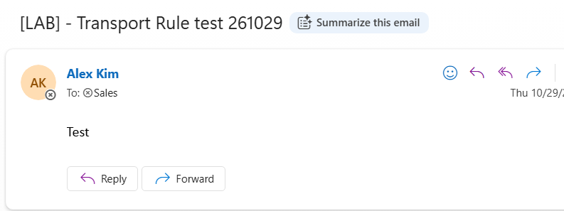
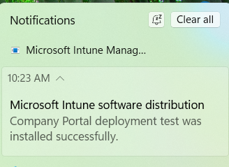
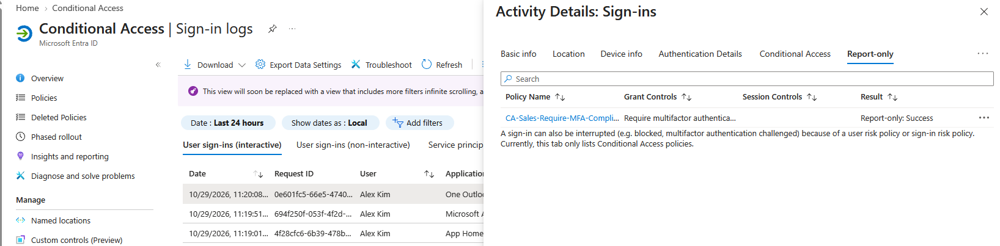

# Microsoft 365, Entra ID & Intune Administration Lab

This project demonstrates cloud identity management, Exchange administration, and Windows endpoint deployment in a simulated company. I used a Microsoft 365 Business Premium trial tenant and a Windows 11 Enterprise Evaluation VM in VMware Workstation.

I built the lab to practice common entry-level IT administration tasks: creating and supporting user accounts, managing shared mailbox access, enrolling a Windows device, deploying an app, and checking security policy results.

## What I Built

### Entra ID user and group management

I created a 10-person test workforce across Sales, HR, Finance, IT, and Operations. I created department security groups and assigned the Helpdesk Administrator role to an IT support test account.

### Exchange Online shared mailbox and mail flow

I created a Sales shared mailbox, added three members, and verified Send as access. I also created a mail flow rule that adds a `[LAB] -` tag to messages sent to Sales. A test email arrived with the expected subject prefix.

### Intune enrollment and endpoint compliance

I joined a Windows 11 VM to Entra ID and enrolled it in Intune. I deployed Company Portal to the Sales group and verified installation in Windows. I configured BitLocker encryption and confirmed that the device reported Compliant after it checked in.

### Conditional Access evaluation

I created a policy for the Sales group that requires MFA and a compliant device. I tested it in Report-only mode from the enrolled Windows VM and confirmed a successful policy evaluation.

The policy remains in Report-only mode, so this result confirms evaluation only. It does not mean the policy enforced MFA or blocked access.

## Lab Notes

The default inbound anti-spam policy was shown as Always on. Custom anti-spam and anti-malware policy creation returned a Microsoft Exchange DirectInvoke client error, so I have not listed those custom policies as created.

## Environment

- Microsoft 365 Business Premium trial
- Cloud-only Entra ID tenant
- VMware Workstation Windows 11 Enterprise Evaluation VM
- Existing on-premises AD lab kept separate

## Guides

- [HowTo.md](HowTo.md) — configuration steps used in the lab
- [ProblemSolving.md](ProblemSolving.md) — issues found, troubleshooting approach, and results
