# Microsoft 365, Entra ID & Intune Administration Lab

## Phase 1: Cloud Identity and Mail Administration

This personal lab simulates employee onboarding, department-based group management, shared mailbox access, and delegated helpdesk administration. It uses a Microsoft 365 Business Premium trial in a separate test tenant. It is not a production deployment.

## Environment

| Component | Configuration |
| --- | --- |
| Tenant domain | junuihonglab.onmicrosoft.com |
| Subscription | Microsoft 365 Business Premium - Trial |
| Primary administrator | Junui Hong |
| Test workforce | 10 employees across Sales, HR, Finance, IT, and Operations |
| Identity model | Cloud-only; existing VMware Active Directory lab remains separate |
| Endpoint management | Windows 11 Enterprise Evaluation VM joined to Entra ID and enrolled in Intune |

## 1. User Provisioning and Licensing

Created Alex Kim as a cloud user with username **alexkim@junuihonglab.onmicrosoft.com** and job title Sales Associate. After initially observing the account as unlicensed, assigned Microsoft 365 Business Premium and verified the assignment in Active users. Reset Alex's temporary password and verified Microsoft 365 sign-in.

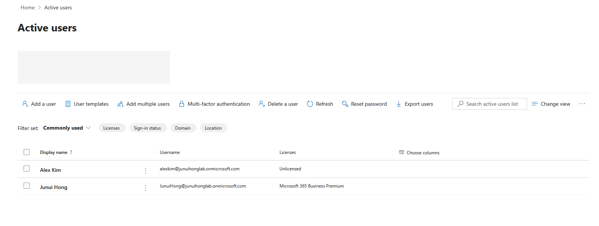

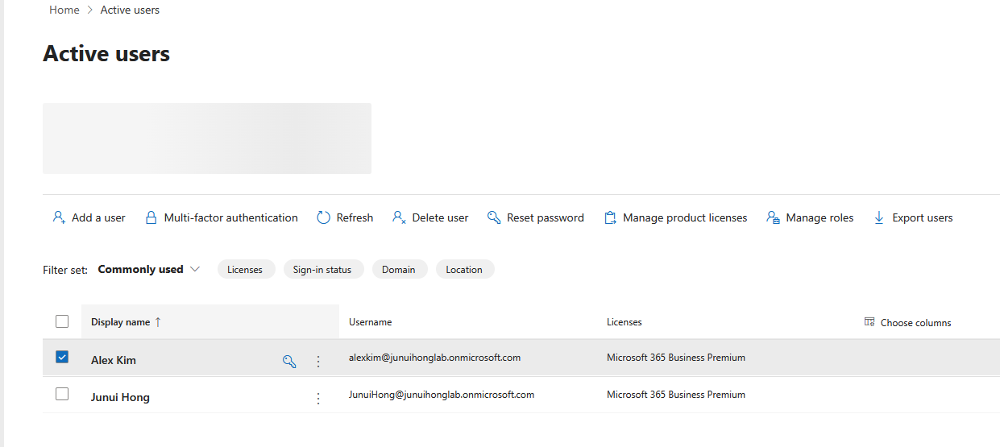

Created nine additional test employees and populated their department and job title information.

| Employee | Department | Job title |
| --- | --- | --- |
| Alex Kim | Sales | Sales Associate |
| Emma Lee | Sales | Sales Associate |
| Daniel Park | Sales | Sales Manager |
| Olivia Chen | HR | HR Coordinator |
| James Wilson | HR | HR Manager |
| Sophia Patel | Finance | Accountant |
| Ethan Brown | Finance | Finance Analyst |
| Mia Garcia | IT | IT Support Technician |
| Noah Smith | IT | IT Administrator |
| Ava Martin | Operations | Operations Coordinator |

The images show initial account creation and Alex's license assignment; they do not establish the license status of all test employees. An IT job title does not itself grant an administrative role.

## 2. Department Security Groups

Created assigned-membership security groups for department-based access and future policy targeting. The Sales group contains Alex Kim, Emma Lee, and Daniel Park. Department groups were created for HR, Finance, IT, and Operations as well.

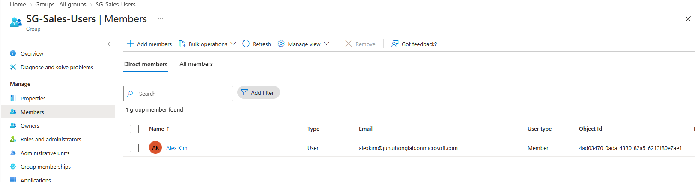

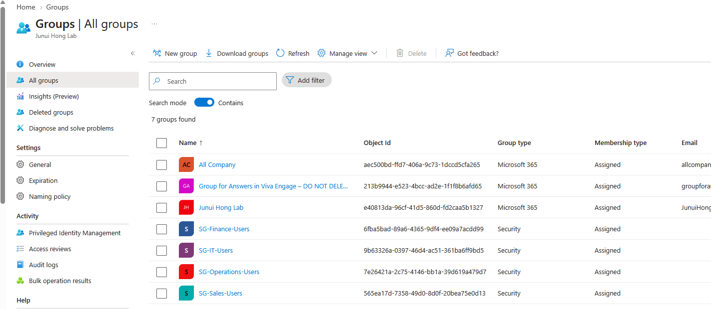

Changing a user's Department attribute does not automatically update assigned group membership. These security groups are intended for access and policy targeting, not as mail distribution lists.

## 3. Sales Shared Mailbox

Created **sales@junuihonglab.onmicrosoft.com** and added Alex Kim, Daniel Park, and Emma Lee as members. The mailbox showed three Read and manage assignments, three Send as assignments, and zero Send on behalf assignments.

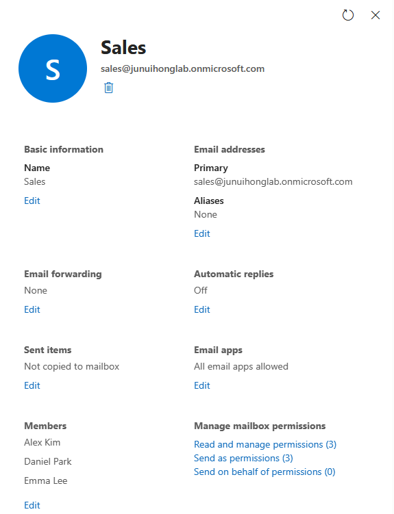

Alex opened the shared mailbox and sent a message using the Sales identity. The message arrived in Junui Hong's mailbox with Sales as the sender.

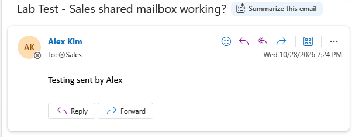

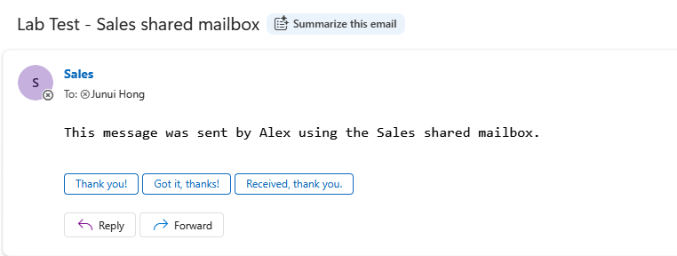

Read and manage permits mailbox access; Send as permits sending using the shared mailbox identity. Reply delivery back to the Sales mailbox was not confirmed. Shared-mailbox sent-item copying was shown as disabled and was not changed.

## 4. Delegated Helpdesk Administration

Assigned the Helpdesk Administrator role to Mia Garcia.

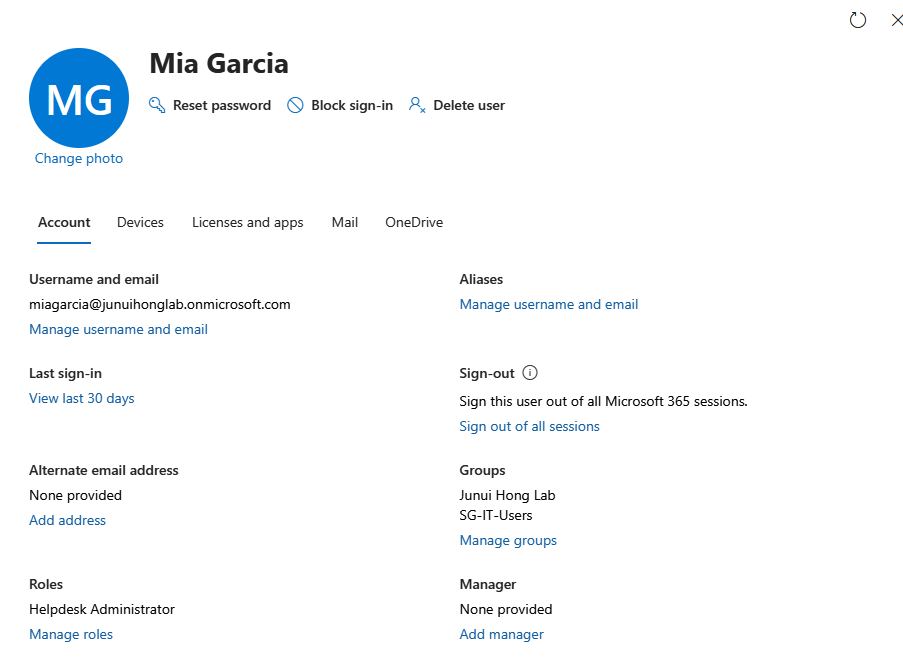

A successful password reset was recorded for a user, followed by Emma Lee's password update/sign-in result.

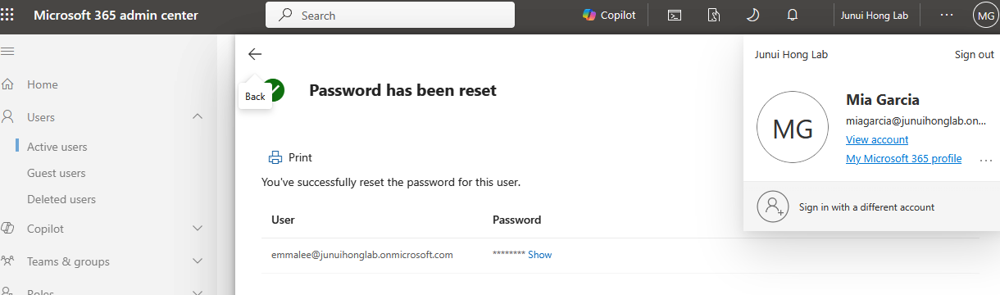

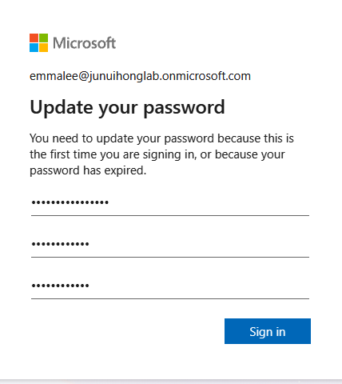

A later attempt to reset Junui Hong's password failed with the message “We could not reset the password for this user” and detail **Junui Hong : null**.

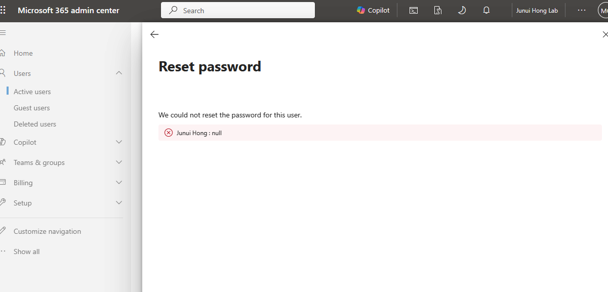

The failure is an observed result. Its generic error does not establish that role restrictions caused it. The acting account and audit details were not captured with the error, so this is not claimed as a verified least-privilege denial.

## Validation Status

| Check | Status |
| --- | --- |
| Alex user creation and Business Premium assignment | Visually verified |
| Alex Microsoft 365 sign-in | Visually verified |
| Alex-to-Junui email delivery | Visually verified |
| Ten-employee roster and department group completion | Operator reported; initial user and group list screenshots available |
| Alex membership in SG-Sales-Users | Visually verified |
| Sales mailbox creation and permission counts | Visually verified |
| Sales sender message delivery to Junui | Visually verified |
| Mia Helpdesk Administrator assignment | Visually verified |
| Mia password reset success | Screenshot available |
| Emma password update/sign-in result | Screenshot available |
| Junui password reset attempt | Failure visually verified; cause unconfirmed |
| Reply receipt in Alex/Sales mailbox | Not confirmed |

Screenshots are embedded under the corresponding lab activity and stored in [resources/](resources/). Do not publish passwords, temporary passwords, MFA QR codes, recovery codes, or payment information.

## 5. Windows Endpoint Enrollment and BitLocker Compliance

Created a Windows 11 Enterprise Evaluation x64 virtual machine in VMware Workstation with 8 GB RAM, 2 vCPUs, and an 80 GB virtual disk. The VM uses bridged networking so it can reach the internet without changing the existing Active Directory lab's VMnet8 network.

Signed in as Alex Kim and connected Windows to Junui Hong Lab's Microsoft Entra ID.

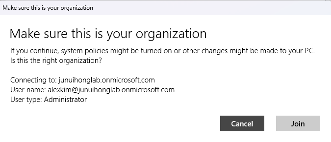

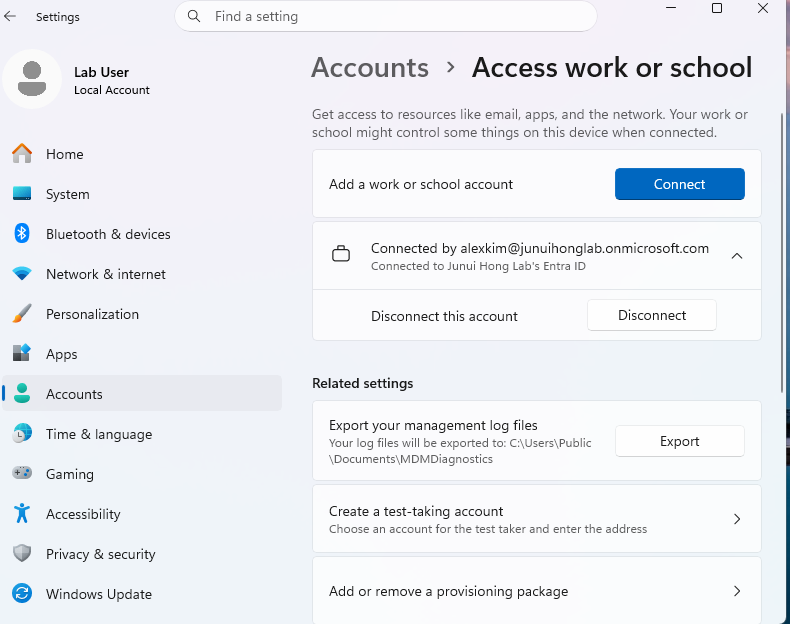

Enrolled the VM in Intune. Intune identified it as **DESKTOP-3SO75PG**, with Alex Kim as the primary user and VMware as the device model. The device initially appeared as **Personal** ownership.

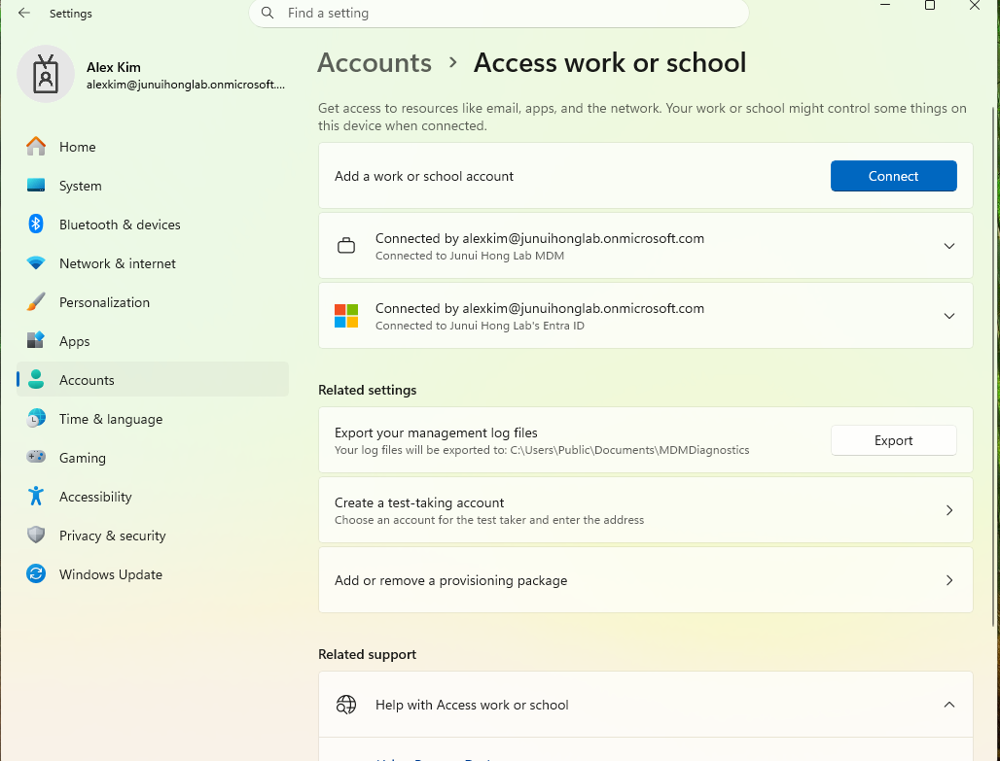

Triggered a device sync from Windows and checked the device status in the Intune admin center.

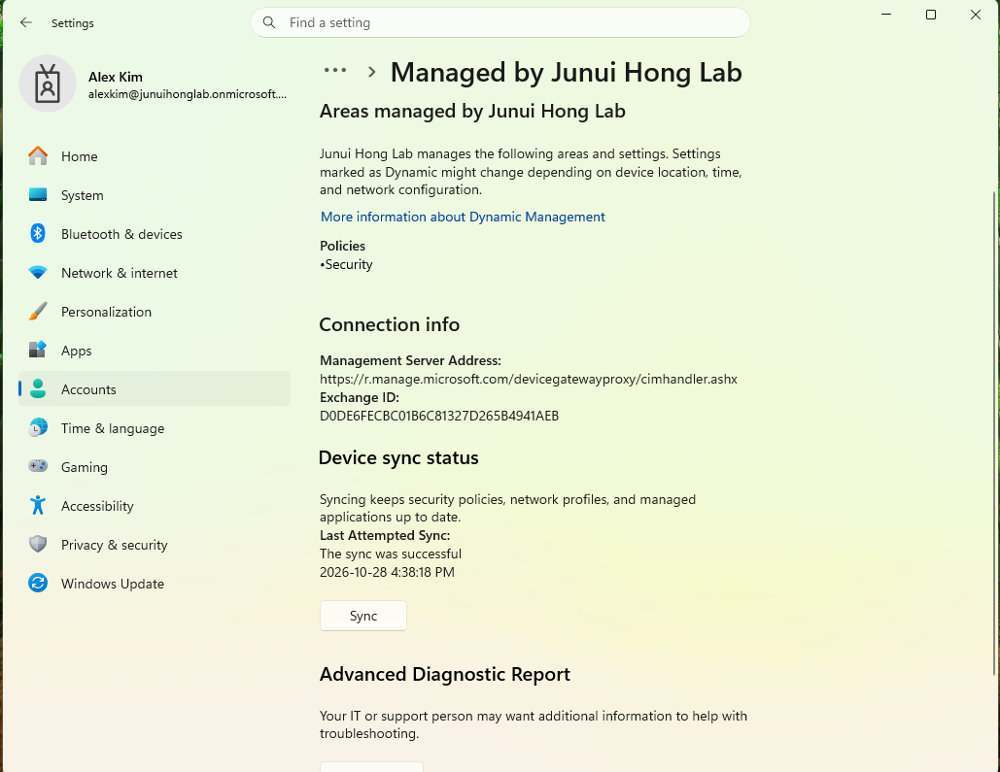

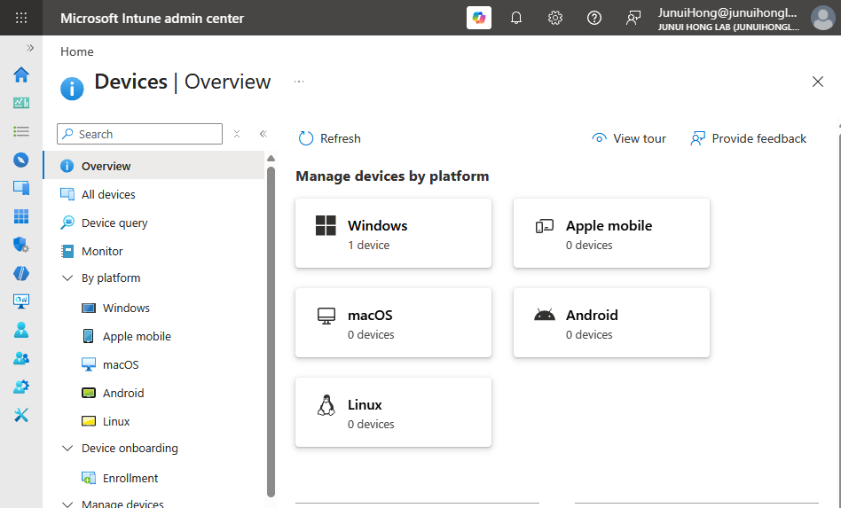

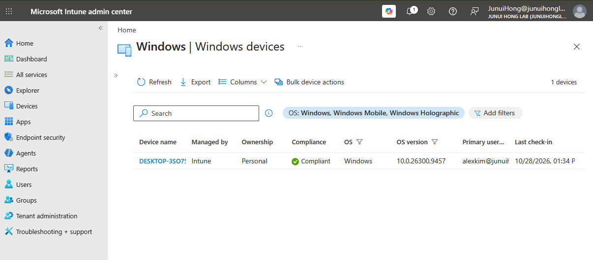

Created the Windows compliance policy **WIN-COMP-Sales-BitLocker** and assigned it to **SG-Sales-Users**. It requires BitLocker. The device first reported **Not compliant** because BitLocker was off.

Created the endpoint security disk-encryption policy **WIN-ENC-Sales-BitLocker**, assigned to the same Sales group. After detaching the Windows installation ISO from the VM's virtual CD/DVD drive and retrying BitLocker, encryption began on the C: drive.

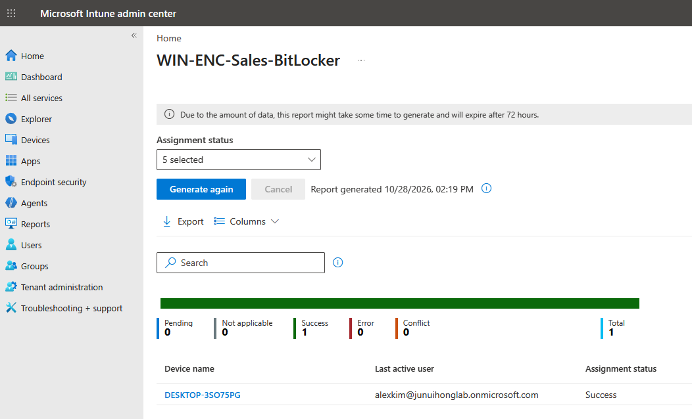

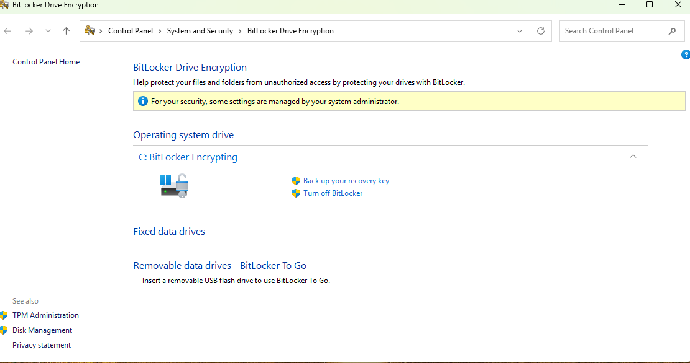

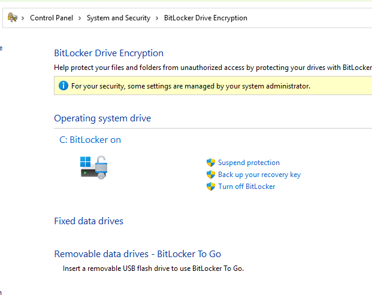

The recovery key was confirmed present in Intune; the key itself is intentionally not included in this repository. After the device checked in again, Intune showed it as **Compliant**, confirming the BitLocker compliance requirement passed on this lab endpoint.

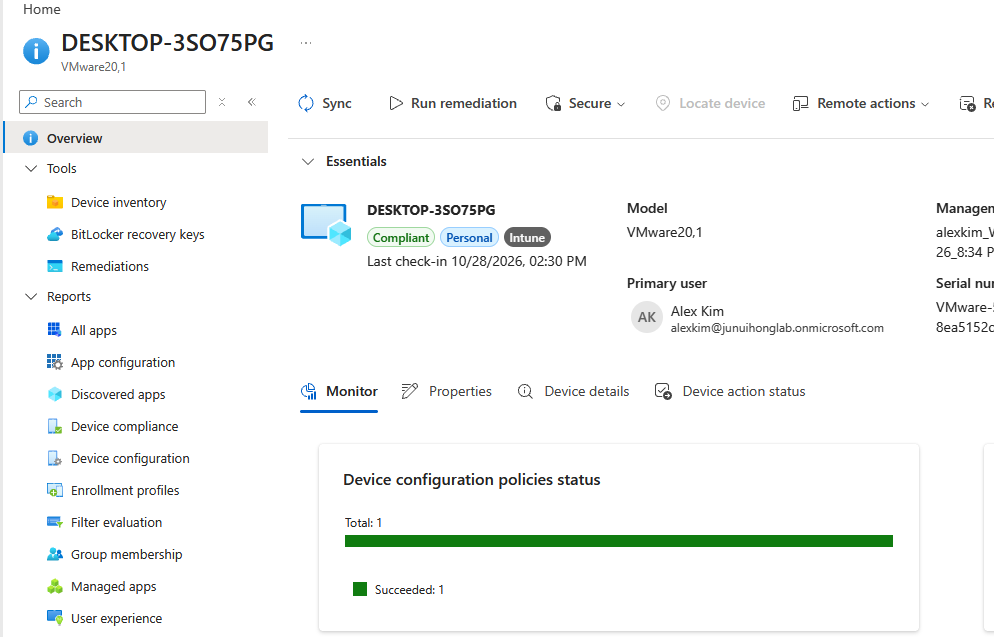

This is a single-device lab validation using a Windows evaluation image. No app deployment or Conditional Access enforcement has been completed yet.

## Validation Status

| Check | Status |
| --- | --- |
| Windows 11 Enterprise Evaluation VM created | Visually verified |
| Device joined to Microsoft Entra ID | Visually verified |
| Device enrolled in Intune and sync completed | Visually verified |
| Sales BitLocker compliance policy created and assigned | Visually verified |
| Initial noncompliance because BitLocker was off | Visually verified |
| BitLocker encryption enabled on C: | Visually verified |
| Recovery key present in Intune | User confirmed; key not published |
| Device reports Compliant after check-in | Visually verified |
| Silent app deployment | Not completed |
| Conditional Access enforcement | Not completed |
| Reply receipt in Sales shared mailbox | Not confirmed |

Screenshots are embedded under the corresponding lab activity and stored in [resources/](resources/). Do not publish passwords, temporary passwords, MFA QR codes, recovery codes, or payment information.

## Next Steps

1. Deploy a small utility app to the Intune-managed VM and verify installation status.
2. Build a Conditional Access test policy for MFA and compliant-device access, using safe exclusions to avoid locking out the administrator.
3. Optionally extend the cloud-only lab with the existing on-premises Active Directory environment after documenting the current cloud configuration.
